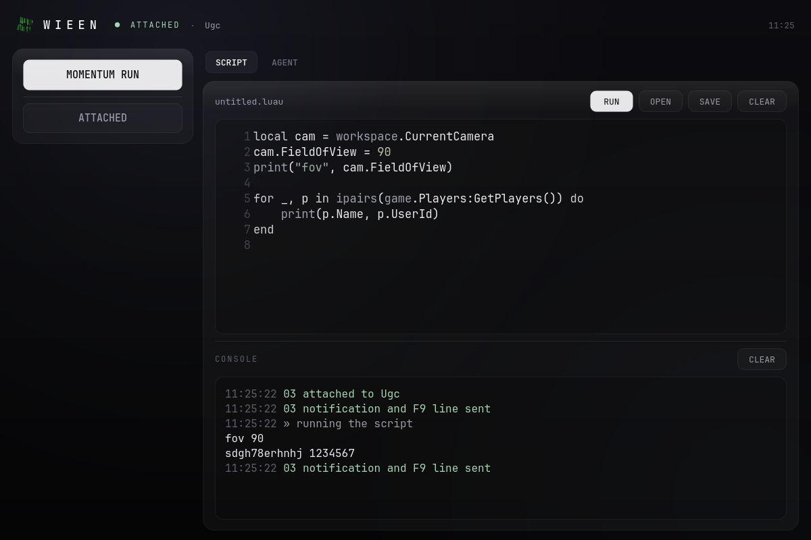
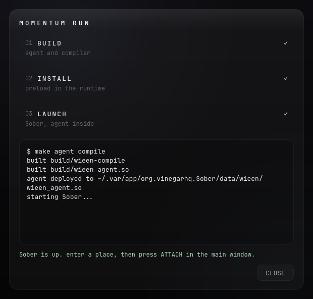

<p align="center">
  
</p>

<h1 align="center">Wieen</h1>

<p align="center">
  A Luau injector for <b>Sober</b> — the Roblox runtime for Linux.
</p>

<p align="center">
  
  
  
  
  
</p>

<p align="center">
  <a href="README.ru.md">Русская версия</a>
</p>

---

Sober runs the Android client of Roblox (x86_64) inside a flatpak sandbox.
Wieen loads itself into that client, finds the Luau VM the game is already
running, and executes Luau inside it — with `game`, `workspace` and the whole
API the game's own scripts get.

```console
$ python3 src/cli/wieen.py exec 'return typeof(game)'
Instance

$ python3 src/cli/wieen.py exec 'return tostring(workspace.CurrentCamera.FieldOfView)'
70

$ python3 src/cli/wieen.py exec 'local f = loadstring("return 6*7") return f()'
42

$ python3 src/cli/wieen.py exec 'local f = loadstring("https://example.com/script.luau") return f()'
```

`loadstring` takes source code, and it also takes a link: the host downloads
it, compiles it and hands the client a real function. Big sources are split
the same way as ordinary scripts, and the chunk gets the stub of its own, so
a downloaded script may `loadstring` another one — a link inside a link works
too. The client has no HTTP client of its own (`game:HttpGet` does not exist
there), so every download happens on the host: `game:HttpGet(url)` and
`game:HttpGetAsync(url)` are rewritten into a call of the host, and the usual
`loadstring(game:HttpGet(url))()` is turned into `loadstring(url)` — the link
goes straight to the compiler, without the text passing through the client.

## Features

| | |
|---|---|
| **Runs in the game's own VM** | No interpreter, no reimplementation: the script is compiled on the host, translated into the client's bytecode format, loaded by the client's own loader and run by the client's own VM. |
| **Real capabilities** | The chunk is lent the capabilities of the game thread, so `Instance.new`, property writes and camera access work — not just reading `game`. |
| **No code patching** | Not a single byte of the client is rewritten. The hook lives in the writable callback slot of the Luau state, which the client's integrity check never looks at. |
| **Long scripts** | The client's 280-byte loader threshold is a format switch, not a limit: anything at or past it is wrapped into a version-1 container whose signature does not depend on the payload. One chunk goes up to 4 MiB, one socket message up to 16 MiB, and longer scripts are still split at statement boundaries. Infinite Yield (605,731 bytes of bytecode) loads as a single chunk and builds its GUI. |
| **`loadstring`** | Compiled by the host, loaded by the client, returned as a real function. A link is downloaded, compiled and split the same way. |
| **Greets the player** | As soon as the experience is selected, the agent posts a `pwned by Wieen` notification through the client's own API and writes a line into the F9 console. |
| **UNIX socket, plain text** | The host talks to the agent over `wieen.sock`; anything that can write to a socket can drive it. |

## The interface

<p align="center">
  
</p>

```sh
make gui                        # or: python3 src/gui/wieen_gui.py
python3 src/cli/wieen.py gui    # the same, from the CLI
```

Two buttons and two tabs. **MOMENTUM RUN** does the setup by itself: it opens
a window that builds the agent and the compiler, registers the preload in the
flatpak runtime (sudo when the ticket is warm, otherwise the polkit dialog)
and starts Sober, marking each step as it goes and streaming the output.
Then the window has nothing left to do — you enter a place and press
**ATTACH**: the agent is asked where it is, and if the client is still in the
menu it says so instead of pretending; once inside, the greeting is posted,
the notification and the F9 line.

<p align="center">
  
</p>

The workspace has two tabs — **script** and **agent**. The console is
part of the script page, directly below the editor, so code and output stay
visible together. A switch between tabs is alive: the page slides in from the
side it came from, blurring from 16 to 0 while the veil over the stack burns
off, and the pill of the tab bar travels with a slight overshoot.

After the attach the script tab is live: `RUN` (or `ctrl+enter`) compiles the
script on the host and runs it in the game's VM; the console below the
editor shows what it printed and reports errors in red.
`ctrl+o` / `ctrl+s` open and save `.luau` files. Nothing is painted with the
default Qt palette: panels are frosted sheets, buttons are drawn by hand, and
the only colours that mean anything are the state of the agent and errors.

## How it works

```
host                        agent (inside the client process)      client
────                        ─────────────────────────────────      ──────
wieen-compile  ──bytecode──▶  UNIX socket
                              waits for the next pre-resume
                              lua_newthread + luau_load
                              lua_resume  ───────────────────────▶  game VM
                              reads the result  ◀────────────────
```

**1 — Injection.** `tools/install_preload.sh` edits `etc/ld.so.preload` in the
GNOME flatpak runtime. The runtime strips `LD_PRELOAD` and `LD_AUDIT` from the
client's environment, but `ld.so.preload` still reaches the client process
(the client is started by Sober's own `libloader.so`, which goes through
`ld.so` all the same).

**2 — Hook.** The agent finds the client image in its own address space and
locates `lua_resume`, `luau_load`, `lua_newthread` and `lua_tolstring` by
offset, verified against signatures. Patching `lua_resume` itself is not an
option: the client checks the bytes of its own code and exits about a minute
after start, even when the instruction is re-encoded into an equivalent one.
So the hook goes into writable memory instead — the agent finds the Luau
`global_State` and puts its handler into the `pre-resume` callback slot, the
pointer the VM calls before every script it runs. That is a safe place for
foreign code: same thread, same state, right before the game's own work.

**3 — Execution.** The agent creates a thread (`lua_newthread`), loads the
bytecode into it (`luau_load`) and resumes it (`lua_resume`). The state is
shared with the game, so everything the game can see is in reach.

**4 — Its own opcode numbering.** The client numbers Luau opcodes differently
from upstream: it has its own internal mapping (95 live slots scattered over
`0..254`) and its own bytecode numbering, which it translates to the internal
one while loading. `tools/opcode_map.py` recovers both tables from the client
image and generates `tools/opcode_map.h`; `tools/wieen_compile.cpp` translates
the bytecode before it is sent.

## In-game greeting

When the VM of the experience is chosen, the agent shows the player that it is
there. Both channels belong to the client itself — no custom ScreenGui:

```lua
local LOGO = "rbxassetid://113328400853000"   -- docs/logo.png, uploaded once

local sg = game:GetService("StarterGui")
local opt = {}
opt.Title = "pwned by Wieen"
opt.Text = "t.me/WieenExploit"
opt.Duration = 10
opt.Icon = LOGO
sg:SetCore("SendNotification", opt)

print("pwned by wieen! t.me/WieenExploit")
```

* `SetCore("SendNotification")` draws the toast in the corner of the screen and
  the client removes it after `Duration`.
* `print` lands in the F9 developer console as `FLog::CreatorOutput` — visible
  in `sober_logs/latest.log` as
  `Info [FLog::CreatorOutput] pwned by wieen! ...`.

The script lives in `tools/toast.luau`, is compiled into the agent the same
way as the probe, and runs through the ordinary command path — so it gets the
same lent capabilities and the same checker guard as your own snippets. While
the place is still loading it answers `"wait-player"`, `"wait-gui"` or
`"wait"`, and the agent retries once a second for ten minutes.

## What Sober turned out to forbid

| limitation | details |
|---|---|
| `LD_PRELOAD` is stripped | Sober removes it from the client's environment (`check_security` in the launch log) |
| `LD_AUDIT` as well | Inside the sandbox `ld.so` loads libraries as audit modules, which need a `la_version` symbol |
| The client is not started by `ld.so` | The client process starts through Sober's own loader (`libloader.so`), so `LD_PRELOAD` never reaches it — but `ld.so.preload` does |
| Sober checks its own files | Replacing `libbadcpu.so` or the APK makes the runtime refuse to start; the APK is re-downloaded on every launch |
| The client cannot be traced | The Sober runtime already traces it (`TracerPid`), a second tracer cannot attach |
| syscalls from foreign code | The seccomp filter kills the client on a system call made from injected code, so the agent makes no syscalls while it works |

## Build

```sh
make agent    # build/wieen_agent.so — the agent (with the probe bytecode in it)
make compile  # build/wieen-compile — the host-side compiler
make deploy   # build the agent and put it where Sober picks it up
make install  # the same, and register the agent in the flatpak runtime (root)
make symbols  # regenerate src/agent/luau_symbols.h for the current client
```

## Run

```sh
# once: put the agent into the runtime
make install

# start the game
python3 src/cli/wieen.py launch

# in another terminal — run a snippet
python3 src/cli/wieen.py exec 'print("hello world!")'

# or drive it end to end (starts Sober, waits for the socket, sends the code)
python3 tools/quick_test.py 'return "wieen-ok"' --raw
python3 tools/selftest.py
```

```
usage: wieen {install,launch,status,exec,run,repl}

  install   install the agent and preload it in the runtime
  launch    start Sober with the agent preloaded
  status    check whether the agent is reachable
  exec      run a Luau snippet
  run       run a Luau file
  repl      interactive session
```

The agent is loaded when the client starts, so the game has to be restarted
after `make deploy`.

## Project layout

| path | what it is |
|---|---|
| `src/agent/wieen_agent.c` | the agent: finds the VM state, hooks the `pre-resume` slot, runs Luau, serves the UNIX socket |
| `src/agent/luau_symbols.h` | generated offsets of the Luau API in the client image |
| `src/cli/wieen.py` | host-side CLI |
| `src/gui/wieen_gui.py` | the interface: install, launch, attach, editor, console |
| `tools/wieen_compile.cpp` | host compiler + opcode translation into the client's format |
| `tools/opcode_map.py` | recovers the client's opcode numbering → `tools/opcode_map.h` |
| `tools/opcode_map.txt` | the table: upstream → internal slot → wire number |
| `tools/probe.luau` | the agent's probe: asks the VM what it sees (`game`, `workspace`) |
| `tools/toast.luau` | the greeting: the client's notification + the F9 line |
| `tools/bin2h.py` | binary → C header (the probe and toast bytecode go into the agent at build time) |
| `tools/selftest.py` | a set of snippets run against the live client |
| `tools/quick_test.py` | one snippet in the live client |
| `tools/repeat.py` | one snippet N times: where the session first stops answering |
| `tools/install_preload.sh` | installs the agent into the flatpak runtime |
| `work/luau-src` | reference Luau build (pinned by commit) |
| `work/libs/libroblox.so` | the client image everything is recovered from |
| `docs/` | architecture and reverse-engineering notes |
| `roadmap.md` | what works, what blocks, what to fix in which order |
| `agents.md` | the repository's rules, invariants, diagnostic flags and traps |

## Notes

* The client image is analysed offline (`work/libs/libroblox.so`); the agent
  finds the same functions at runtime either by the image hash (exact offsets)
  or by signatures, so a client update does not have to break the agent.
* After a client update, run `make symbols` and rebuild.
* `loadstring` chunks run in a sandbox of their own: they see our globals, but
  `Instance.new` inside one is refused (`lacking capability CreateInstances`).
  Lifting that is tracked in `roadmap.md`.
